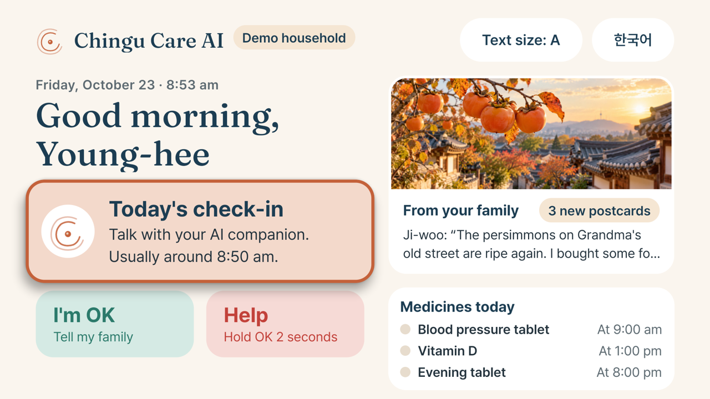
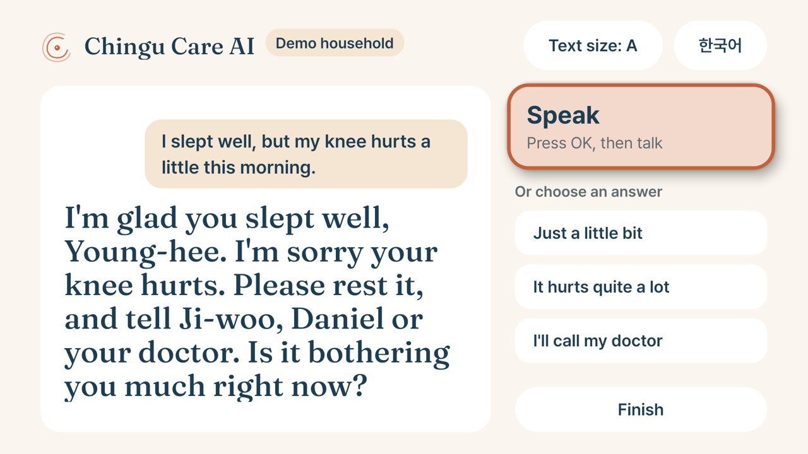
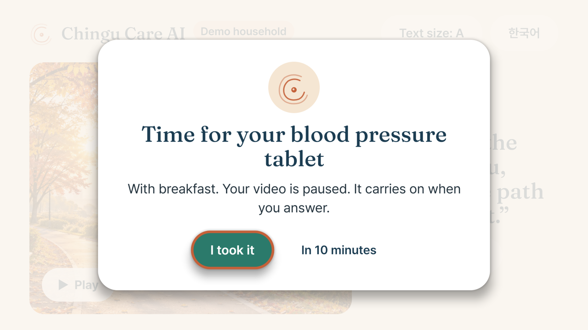
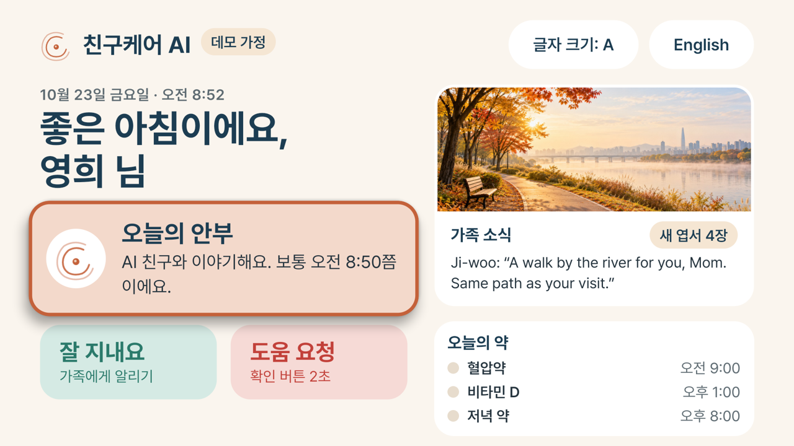
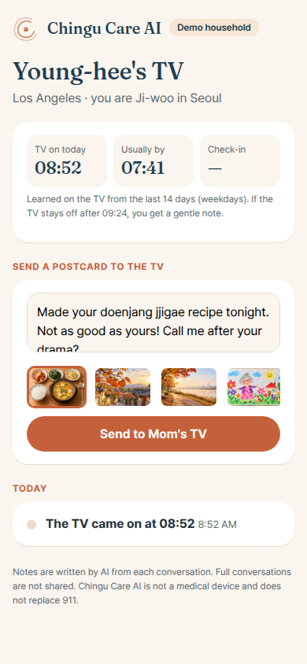
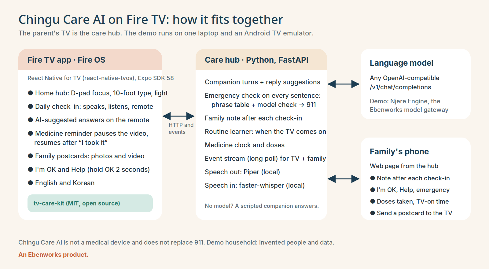

# Chingu Care AI on Fire TV

The parent's TV becomes the care hub. An older parent who lives alone talks with an AI companion on the big screen each morning, answers with their voice or the remote, gets medicine reminders that pause what they are watching and resume when they confirm, sees photo and video postcards from their children, and can tell the family "I'm OK" or ask for help with one button. After each check-in the family gets a short note, written by AI, on their phone.

Built for the Build, Ship, Shape: Amazon Developer Hackathon, Fire TV track. MIT licence. Chingu Care AI is an Ebenworks product.



## Run it

You need Node.js 20+, Python 3.11+, the Android SDK platform-tools (`adb`) and either an Android TV emulator or a Fire TV with ADB debugging on.

```bash
./run-demo.sh
```

That one command starts the care hub, builds the release app, installs it on the first device `adb` sees and opens it. The family's phone page is then at http://localhost:8797/family.

- Without a model the hub's scripted companion answers, so the app works with no keys.
- With a model: `LLM_BASE_URL=https://your-endpoint LLM_API_KEY=... LLM_MODEL=... ./run-demo.sh` (any OpenAI-compatible `/v1/chat/completions`; `LLM_CHECK_MODEL` sets a smaller model for the emergency check).
- On a Fire TV: `adb connect <tv-ip>:5555`, then `HUB_URL=http://<this-computer-ip>:8797 ./run-demo.sh`.
- `DEMO_START=08:52` starts the household's clock at 8:52 am, so the 9:00 medicine reminder fires a few minutes in. `curl -X POST localhost:8797/api/demo/remind/bp` fires it at once.

To create the emulator we used: Android Studio's SDK Manager, system image "Android TV Intel x86 Atom, API 30" (Android 11, the version Fire OS 8 is built on), device profile "Television (1080p)". Development with live reload: `npm start` in one terminal and `npm run android` in another.

## What the parent does

| On the TV | How |
| --- | --- |
| Morning check-in | Press OK on "Today's check-in". The companion says "Hello, this is your AI companion." and asks one question at a time, aloud and in large type. Answer by voice (press OK on Speak, talk, press OK again) or pick one of three answers the AI suggests for this moment with the D-pad. |
| Medicine | At the set time a reminder covers the screen and pauses any video. "I took it" resumes the video and tells the family; "In 10 minutes" asks again later. |
| Family postcards | Photos and video postcards from the children, newest first. A new one appears as a notice wherever the parent is. |
| I'm OK | One press tells every family member, with the time. |
| Help | Press for a confirmation, or hold OK for 2 seconds to send at once. The screen says the button does not call emergency services and names 911. |
| Text size and language | Three text sizes; English or Korean. |

| Answering by voice | A reminder that paused a video | Korean |
| --- | --- | --- |
|  |  |  |

Every sentence the parent says is checked for an emergency: a phrase table runs first and a second model checks the sentence beside it. If either finds one, the companion says "Please call 911 right now. I can't make the call for you." and the family is alerted. Chingu Care AI is not a medical device and does not replace 911.

## What the family sees

The hub serves a phone page for the adult child: the note after each check-in (a paraphrase, never the conversation), I'm OK, Help and emergency alerts, doses taken, when the TV came on compared with the household's usual morning, and a box to send a postcard to the TV.



## How it works



- **Fire TV app** (`App.tsx`, `src/`): React Native for TV through [react-native-tvos](https://github.com/react-native-tvos/react-native-tvos) 0.88 on Expo SDK 58, prebuilt for Android TV and Fire OS with `@react-native-tvos/config-tv` (leanback launcher, 320×180 banner, no touchscreen). Focus is handled with `hasTVPreferredFocus`, `TVFocusGuideView` (rows that remember focus, dialogs that trap it) and focus that returns to the control the parent was using after a reminder or dialog. The Back button always goes one step towards home. Chingu Care AI's voice is played with `expo-audio`; the parent's answers are recorded with `expo-audio` and transcribed on the hub. Postcards play with `expo-video`.
- **Care hub** (`hub/`): one FastAPI file. It runs the conversation (`companion.py`), the emergency check, the family note, the medicine clock, the routine learner (`household.py`) and an event stream the TV and the family page long-poll. Speech out uses [Piper](https://github.com/rhasspy/piper) with the public-domain LJSpeech voice; speech in uses [faster-whisper](https://github.com/SYSTRAN/faster-whisper). Both run on the hub's own computer.
- **Routine learner**: the TV tells the hub when it comes to the front each day. From the last 14 days the hub learns the household's usual morning (weekday and weekend apart), shows the family when the TV came on today against that, suggests the check-in time and sets the hour after which a quiet TV becomes a gentle note to the family.
- **tv-care-kit** (`kit/`): the reusable part, published on its own under MIT at [gitlab.com/ebenworks-systems/tv-care-kit](https://gitlab.com/ebenworks-systems/tv-care-kit). Focus you can see from the sofa, a 10-foot type scale with an 18 dp floor, and the interrupt-and-resume state machine behind the medicine reminder.

## Tests

```bash
npm test          # 16 kit tests (Node's built-in runner) and 6 hub tests (pytest)
npx tsc --noEmit  # type check
```

The hub tests run without a model: the routine learner, the emergency phrase table in English and Korean, a full check-in, an emergency reaching the family, a postcard reaching the TV and input checks.

## Before and after the hackathon

Chingu Care AI existed before the submission window: it was built from March 2026, tested and piloted with users from March 2026, and launched on 20 October 2026 as phone apps for the parent and the family (Android on Google Play) with an AI check-in call, medicine reminders, an SOS button and a note to the family after each call.

Everything in this repository is new in the window: the TV app, the care hub, the routine learner, the family phone page, the interrupt-and-resume reminder and the tv-care-kit. It keeps the product's rules (the AI notice at the start, no diagnosis, the emergency line, a paraphrased note instead of a transcript) and its look, but shares no code with the phone apps or their backend.

## Demo data

Park Young-hee, Ji-woo, Daniel and Mina are invented, and so are their messages, medicines and 14 days of routine. The photos are generated illustrations. No real user's data is in this repository or in the film.

## Code hosting

The company's GitHub account is under review by GitHub, so this code is on GitLab, public and MIT-licensed; a GitHub copy follows when access returns.

## Licence

MIT, see [LICENSE](LICENSE). Fonts: Pretendard and Fraunces, both under the SIL Open Font License (`assets/fonts/`). Copyright 2026 Ebenworks Systems (Private) Limited.
