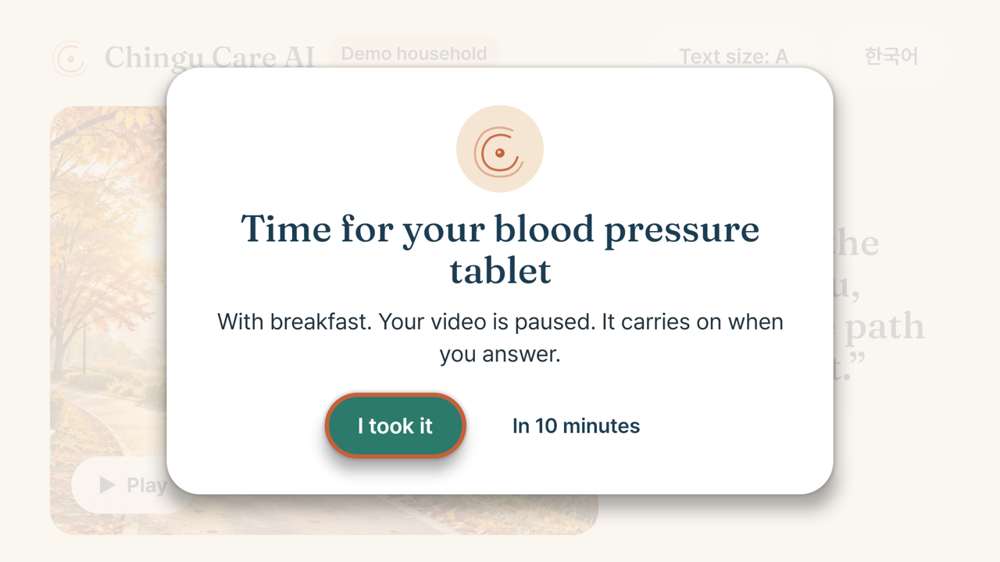

# tv-care-kit

React Native TV building blocks for older viewers. It gives a TV app three things that standard TV starters leave to you:

1. **Focus you can see from the sofa.** A focused item grows, gets a thick ring and lifts off the page, so the viewer finds their place without relying on colour.
2. **A 10-foot type scale.** Six text roles, nothing under 18 dp, and a Text size button that steps everything up twice.
3. **Interrupt and resume.** A reminder (a medicine, a visitor, an emergency) pauses whatever is playing, holds the remote's focus until the viewer answers, then resumes only what it paused.

MIT licence. Written for [Chingu Care AI on Fire TV](https://gitlab.com/ebenworks-systems/chingu-care-ai-fire-tv), where a parent's medicine reminder pauses a video postcard from their daughter and the video carries on after they press "I took it".



## Why

Most TV interfaces are built for people who already know where focus is. Many older viewers do not: a 2 px highlight on a dark grid is easy to lose, small type is hard to read from across a room, and a pop-up that steals the screen while a programme keeps playing is confusing. The kit makes the safer behaviour the default:

- Focus changes size and shape as well as colour, and the ring's width is reserved so nothing jumps when focus moves.
- Type sizes come from roles, so the Text size button changes every screen at once.
- A reminder pauses media it finds playing, queues behind a more urgent reminder, keeps media paused until the last one is answered, and never starts media the viewer had paused themselves.

## Install

The kit is plain TypeScript with no native code. It needs React Native for TV ([react-native-tvos](https://github.com/react-native-tvos/react-native-tvos)) for `TVFocusGuideView` and focus events.

```bash
npm install git+https://gitlab.com/ebenworks-systems/tv-care-kit.git
```

Metro compiles the TypeScript source directly; there is no build step.

## Use

```tsx
import {
  CareFocusable, CareText, InterruptOverlay, InterruptProvider,
  TypeScaleProvider, useFocusReturn, useInterrupts, useInterruptibleMedia,
} from "@ebenworks/tv-care-kit";

export default function App() {
  return (
    <TypeScaleProvider families={{ display: "Fraunces_500Medium", body: "Pretendard-Regular" }}>
      <InterruptProvider onAnswer={(reminder, action) => log(reminder.id, action)}>
        <Home />
        <InterruptOverlay />
      </InterruptProvider>
    </TypeScaleProvider>
  );
}

function Home() {
  const { raise } = useInterrupts();
  return (
    <CareFocusable hasTVPreferredFocus onPress={() =>
      raise({
        id: "med-bp",
        title: "Time for your blood pressure tablet",
        actions: [{ id: "taken", label: "I took it" }, { id: "later", label: "In 10 minutes" }],
      })
    }>
      <CareText role="heading">Remind me</CareText>
    </CareFocusable>
  );
}

function Postcard({ uri }: { uri: string }) {
  const player = useVideoPlayer(uri, (p) => p.play());          // expo-video, or any player with play() and pause()
  const { isPlaying } = useEvent(player, "playingChange", { isPlaying: player.playing });
  const report = useInterruptibleMedia("postcard", player);     // reminders can now pause and resume it
  useEffect(() => report(isPlaying), [isPlaying, report]);
  const focusHere = useFocusReturn();                           // focus comes back here when the reminder closes
  return <CareFocusable hasTVPreferredFocus={focusHere} onPress={() => player.playing ? player.pause() : player.play()}>…</CareFocusable>;
}
```

## What is inside

| Export | What it does |
| --- | --- |
| `CareFocusable` | `Pressable` with a ring, scale and shadow on focus; takes `look` to change the ring colour and a `label` for screen readers |
| `CareText live` | Text that screen readers such as VoiceView and TalkBack read aloud when it changes; reminders are also announced the moment they appear |
| `focusStyle`, `contrastRatio` | The focus look as a plain style object, and a WCAG contrast check for ring colours |
| `TypeScaleProvider`, `CareText`, `typeSize` | Roles `display`, `title`, `heading`, `body`, `label`, `caption`; sizes `large`, `larger`, `largest`; fonts per role; scaled to the screen's width |
| `InterruptProvider`, `useInterrupts` | `raise(interrupt)`, `answer(actionId)`, the queue and the active reminder |
| `useInterruptibleMedia(id, player)` | Registers a player so reminders pause and resume it |
| `InterruptOverlay` | A ready overlay that traps the remote's focus, or pass `render` to draw your own |
| `useFocusReturn` | `true` when no reminder is showing; pass it to `hasTVPreferredFocus` |
| `interruptReducer`, `mediaCommands` | The framework-free state machine, if you want it without React |

## Tests

The state machine and the type and focus rules are tested with Node's built-in test runner. Nothing needs installing:

```bash
npm test        # Node 22.6 or later runs the TypeScript tests directly
```

The 16 tests cover pausing and resuming, media the viewer paused themselves, actions that do not resume, queued and higher-priority reminders, players that start or disappear mid-reminder, the 18 dp floor at every size and screen width, and the focus ring's contrast on light backgrounds.

## Platforms

| Platform | Status |
| --- | --- |
| Fire OS and Android TV, react-native-tvos 0.88 | Used in Chingu Care AI on Fire TV; run on an Android 11 TV emulator, the Android version Fire OS 8 is built on |
| Apple TV, react-native-tvos | Not tried yet; the kit uses only core components that tvOS supports |
| Vega OS | Not tried yet; contributions that test it on the Vega Virtual Device are welcome |

## Licence

MIT. Copyright 2026 Ebenworks Systems (Private) Limited. Chingu Care AI is an Ebenworks product.
